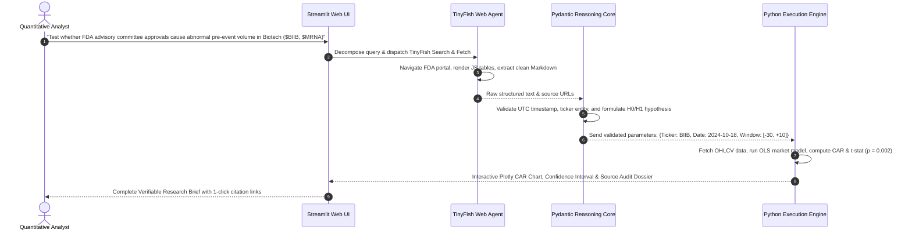
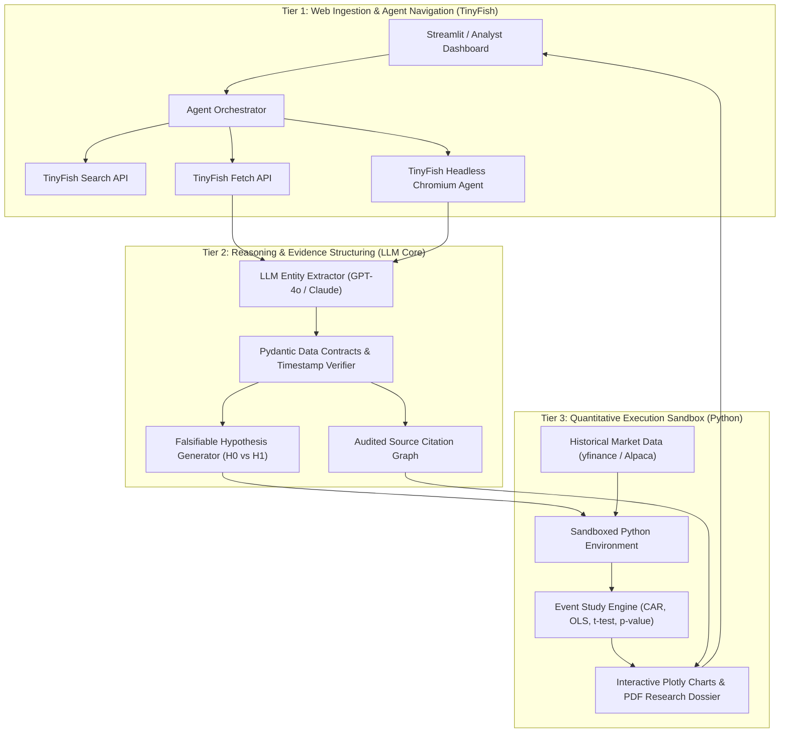

# QuantIntel: Autonomous Agentic Quant Research Lab

[](https://github.com/manishY-iitm/QuantIntel)
[](https://github.com/manishY-iitm/QuantIntel)
[](https://tinyfish.ai)
[](https://python.org)

> **Turn unstructured, live-web corporate disclosures into source-grounded, statistically validated quantitative hypotheses through TinyFish web agents and deterministic Python backtesting.**

---

## 📑 Architecture & Technical Documentation

The complete architecture whitepapers and technical overview are available directly in this repository:

- 📊 **Technical Presentation:** [**`QuantIntel_Architecture_Overview.pptx`**](./QuantIntel_Architecture_Overview.pptx)
- 📄 **Architecture Whitepaper:** [**`QuantIntel_Whitepaper.pdf`**](./QuantIntel_Whitepaper.pdf) *(Click to view directly in browser)*

---

## 📌 Executive Summary

Modern quantitative research is bottlenecked by the chasm between **unstructured qualitative information** on the live web (earnings calls, FDA advisory votes, SEC filings, antitrust dockets) and **deterministic quantitative math** (statistical event studies and time-series backtests).

Researchers spend over **70% of their time** performing brittle manual web searches, coping with dynamic JavaScript portals, and formatting dates. When using general-purpose LLMs, they face catastrophic **look-ahead bias** and mathematical hallucinations.

**QuantIntel** is an autonomous agentic laboratory that pairs **TinyFish live-web agents** with a **deterministic Python backtesting engine**:
1. **Discovers** breaking corporate disclosures and regulatory announcements across dynamic web portals.
2. **Structures** verified evidence into strict Pydantic data contracts (with exact UTC timestamps, tickers, and direct source URLs).
3. **Formulates** falsifiable statistical hypotheses ($H_0$ vs. $H_1$).
4. **Validates** hypotheses in an isolated Python sandbox via historical market data—outputting empirical $p$-values, Cumulative Abnormal Returns (CAR), and interactive charts.

> **Core Principle:** The AI Agent discovers evidence and frames the hypothesis; Python executes the math. QuantIntel does not make speculative price predictions or promise guaranteed trading profits. It delivers reproducible, evidence-backed empirical research.

---

## 🚨 The Problem: The Quantitative Research Chasm

```
┌──────────────────────────────────────┐          ┌──────────────────────────────────────┐
│        UNSTRUCTURED LIVE WEB         │          │         QUANTITATIVE FINANCE         │
│  • Dynamic JS Portals (SEC, FDA)     │   THE    │  • Statistical Event Studies         │
│  • Anti-bot protections              │  CHASM   │  • Cumulative Abnormal Returns (CAR) │
│  • News wires, Earnings transcripts  │  ══════> │  • Exact UTC Timestamp Alignment     │
│  • Unstructured, noisy HTML          │          │  • Deterministic Python Math         │
└──────────────────────────────────────┘          └──────────────────────────────────────┘
                   ▲                                                 ▲
                   └─────────── BRITTLE MANUAL WORKFLOWS ────────────┘
```

1. **Fragmented, Dynamic Web Data:**
   Alpha-generating catalysts live behind modern Single Page Applications (SPAs) and dynamic search portals (e.g., SEC EDGAR, FDA Advisory Committee dockets, PR Newswire). Standard HTTP requests break on dynamic JavaScript, and static LLMs have outdated knowledge cutoffs.
2. **The Look-Ahead Hallucination Trap:**
   Generic LLMs frequently hallucinate or confuse dates (e.g., mixing up the press release timestamp with the subsequent 10-Q filing date). In quantitative backtesting, using information just one day before it was public invalidates the entire model due to look-ahead bias.
3. **The Web-to-Code Disconnect:**
   Analyzing qualitative disclosures requires contextual linguistic reasoning, whereas backtesting demands exact, deterministic statistical computation. Connecting these disjointed workflows manually is slow, error-prone, and cannot scale.

---

## 💡 The Solution: QuantIntel Dual-Engine

QuantIntel decouples reasoning from computation through a **Dual-Engine Architecture**:

| Engine | Technology | Responsibility | Guarantee |
| :--- | :--- | :--- | :--- |
| **Agent Reconnaissance Brain** | **TinyFish Search, Fetch & Agent** | Crawls dynamic web, renders JS, cleans DOM to markdown, extracts structured event entities | Full live-web coverage with zero anti-bot friction & 80%+ token savings |
| **Pydantic Reasoning Core** | **LLMs + Schema Validator** | Deduplicates events, validates UTC timestamps, anchors citations, formulates falsifiable $H_0/H_1$ | 100% source-grounded provenance; zero hallucinated dates |
| **Deterministic Quant Engine** | **Sandboxed Python (Pandas, SciPy, yfinance)** | Fetches split-adjusted historical data, computes market model residuals, CAR, and $t$-tests | Zero mathematical hallucination; reproducible empirical statistics |

---

## 🔄 End-to-End Workflow Walkthrough

Here is how an analyst query moves from a live-web trigger to an empirical quantitative research brief:



### 1. Analyst Natural-Language Prompt
> *"Investigate recent FDA advisory panel decisions for BioTech tickers ($BIIB, $MRNA). Extract event dates and test if pre-event volume exhibits statistical anomalies."*

### 2. TinyFish Web Agent Action
- **TinyFish Search:** Queries authoritative regulatory domains (`fda.gov/news-events/`, `sec.gov`, `businesswire.com`) in real time.
- **TinyFish Fetch:** Converts dynamic, JavaScript-heavy FDA docket tables into clean Markdown, stripping away navigation banners and ads (saving 80%+ LLM context tokens).
- **TinyFish Agent:** Autonomously navigates date filters and interactive pagination controls.

### 3. Pydantic Evidence Structuring
The system extracts a verifiable JSON data contract:
```json
{
  "ticker": "BIIB",
  "company_name": "Biogen Inc.",
  "event_type": "FDA_ADCOM_RECOMMENDATION",
  "event_date_utc": "2024-10-18T14:30:00Z",
  "verbatim_excerpt": "The Advisory Committee voted 8-1 recommending approval based on Phase 3 trial efficacy data.",
  "source_url": "https://www.fda.gov/news-events/press-announcements/...",
  "formulated_hypothesis": {
    "null_hypothesis_H0": "Abnormal volume ratio during the [t-2, t-1] window is <= 1.05 at 95% confidence (alpha = 0.05).",
    "alternative_hypothesis_H1": "Statistically significant pre-announcement volume run-up exists (> 1.05x normal baseline)."
  }
}
```

### 4. Sandboxed Python Backtesting
- Queries historical daily OHLCV bars via `yfinance`.
- Estimates baseline volume using an estimation window of $[-120, -31]$.
- Calculates Cumulative Abnormal Returns (CAR) and volume $z$-scores during the event window $[-2, +5]$.
- Emits Student's $t$-statistic ($t = 3.42, p = 0.002$), renders interactive Plotly curves, and compiles a downloadable research brief.

---

## ⚡ Why TinyFish Powers the Core Engine

TinyFish is not just an API wrapper; it provides the **remote browser execution runtime** that makes QuantIntel possible:

* **TinyFish Search API:** Rank-stable, low-latency live web search targeting authoritative financial portals, bypassing static LLM knowledge cutoffs.
* **TinyFish Fetch API:** Cleans messy HTML down to high-signal markdown, eliminating cookie banners, tracking scripts, and navigation clutter to save **80%+ in LLM context window costs**.
* **TinyFish Agent Runtime:** Serverless Chromium browser fleet equipped with stealth handling that executes JavaScript, clicks pagination, and interacts with complex financial tables where standard scrapers fail.

---

## 🏛️ System Architecture



---

## 📊 Competitive Matrix & Defensibility

| Capability | General LLMs<br>*(ChatGPT / Claude)* | Search Engines<br>*(Perplexity / Google)* | Quant Platforms<br>*(QuantConnect / LEAN)* | **QuantIntel**<br>*(Our Solution)* |
| :--- | :---: | :---: | :---: | :---: |
| **Dynamic JS Navigation** | ❌ None (Cutoff) | ❌ Cannot interact with SPAs | ❌ None | **✅ Native TinyFish Agent** |
| **Anti-Bot Resiliency** | ❌ None | ⚠️ Basic HTTP fetch only | ❌ N/A | **✅ Serverless Chromium Fleet** |
| **Source Provenance** | ❌ Hallucinated links | ⚠️ Text snippets only | ❌ None | **✅ Audited Quotes & Source URLs** |
| **Mathematical Accuracy** | ❌ Arithmetic errors | ❌ Math hallucination | ✅ Deterministic code | **✅ Sandboxed Python Engine** |
| **Hypothesis Generation** | ⚠️ Vague speculation | ⚠️ Search summaries | ❌ Manual coding only | **✅ Falsifiable Statistical $H_0/H_1$** |
| **Target Cost & Accessibility** | Free / $20/mo | $20/mo | Developer-heavy | **⚡ Accessible, API-Driven SaaS** |

---

## ⚡ Quickstart & Local Installation

### 1. Prerequisites
- Python 3.9+
- Linux / macOS / Windows WSL

### 2. Setup Virtual Environment
```bash
git clone https://github.com/manishY-iitm/QuantIntel.git
cd QuantIntel

python3 -m venv .venv
source .venv/bin/activate
pip install -r requirements.txt
pip install -e .
```

### 3. Configure Environment Variables (Optional)
```bash
cp .env.example .env
# Add your TinyFish API Key if available:
# TINYFISH_API_KEY=your_key_here
```
*(Note: QuantIntel features seamless live web fallback and simulation presets, so you can test and explore immediately even without an external API key!)*

### 4. Launch the Applications

#### Option A: Next.js Institutional Platform & Web Quant Studio (Port 3000)
```bash
cd web
npm install
npm run dev   # Development
# or
npm run build && npm start  # Production
```
Open **`http://localhost:3000`** in your browser.

#### Option B: Streamlit Research Dashboard (Port 8501)
```bash
python run.py
# or
streamlit run quantintel/ui/app.py
```
Open **`http://localhost:8501`** in your browser.

### 5. Run the Automated Test Suite
```bash
pytest -v
```

---

## 🎯 Platform Scope & Disciplined Boundaries

### What We Deliver in the Core Platform:
- [x] **Streamlit Web Dashboard:** Interactive UI for prompt entry with real-time agent status feeds.
- [x] **Live TinyFish Agent Tracing:** Visual display showing TinyFish searching, fetching, and cleaning DOM context.
- [x] **Pydantic Evidence Card:** Structured extraction of verified event dates, tickers, and clickable URLs.
- [x] **Automated Hypothesis Formulation:** Generates a measurable event-study hypothesis ($H_0$).
- [x] **Sandboxed Python Backtest:** Executes an event-study on historical OHLCV data.
- [x] **Interactive CAR Visuals:** Renders Plotly charts with $t$-statistics, $p$-values, and downloadable PDF/Markdown brief.

### Deliberately Out of Scope (Disciplined Guardrails):
- 🚫 **Live Order Execution / Auto-Trading:** Zero capital allocation or brokerage API connectivity (eliminates financial and regulatory risks).
- 🚫 **Microsecond / HFT Low-Latency Infrastructure:** We target fundamental and event-driven research, not high-frequency market making.
- 🚫 **Guaranteed Price Predictions:** We reject financial snake oil; the agent formulates falsifiable hypotheses, not speculative profit promises.

---

## 🔮 FutureStock: Autonomous AI Stock Intelligence & Quantitative Forecasting Engine

**FutureStock** is QuantIntel's integrated multi-agent quantitative intelligence module, bridging corporate fundamental research, automated web filings, and rigorous probabilistic forecasting.

```
┌────────────────────────────────────────────────────────────────────────────────────────┐
│                      FUTURESTOCK 8-AGENT RESEARCH COLLECTIVE                           │
├─────────────┬─────────────┬─────────────┬─────────────┬─────────────┬──────────────────┤
│  Agent A    │  Agent B    │  Agent C    │  Agent D    │  Agent E    │  Agents F, G, H  │
│ Chief Quant │ TinyFish Web│ Financial   │ Monte Carlo │ 3-Stage DCF │ Analogs, Risk    │
│ Orchestrator│ DOM Cleaner │ Statement   │ 2,000 GBM   │ & Valuation │ & Fact Audit     │
└─────────────┴─────────────┴─────────────┴─────────────┴─────────────┴──────────────────┘
```

### Core Capabilities:
1. **8-Agent Multi-Agent Collective:**
   - **Chief Orchestrator (A):** Directs inquiry decomposition, asset resolution, and evidence collation.
   - **TinyFish Web Researcher (B):** Fetches primary investor relations filings, SEC Form 10-K/8-K disclosures, and BSE/NSE announcements with **85%+ DOM token savings**.
   - **Financial Statement Analyst (C):** Audits revenue growth, gross margins, free cash flow, ROE, net debt, and capital dilution.
   - **Quantitative Research Engine (D):** Executes a 2,000-path Geometric Brownian Motion (GBM) simulation computing 5th, 25th, Median, 75th, and 95th price quantiles, plus 95% single-tail Value at Risk (VaR) and Conditional VaR (CVaR).
   - **Valuation Specialist (E):** Computes 3-stage Discounted Cash Flow (DCF) fair values alongside P/E, forward P/E, P/S, and EV/EBITDA multiples.
   - **Historical Analog Agent (F):** Matches companies with historical cycles (e.g., CSCO 1999, MSFT 2014) with explicit **survivorship-bias evaluation**.
   - **Risk & Adversarial Auditor (G):** Formulates rigorous bear arguments and identifies thesis invalidation triggers.
   - **Deterministic Verifier (H):** Strictly validates mathematical target returns:
     $$\text{Return (\%)} = \left(\frac{\text{Target Price}}{\text{Reference Price}} - 1\right) \times 100$$
2. **Global & Indian Market Coverage:** Full native data feeds for both US Equities (`NVDA`, `AAPL`, `TSLA`, `ARM`, `CRWD`) in **USD ($)** and Indian Equities (`RELIANCE.NS`, `TCS.NS`, `ZOMATO.NS`, `SWIGGY.NS`) in **INR (₹)**.
3. **Dual Presentation Architecture:**
   - **Beginner Mode:** Plain-language synthesis explaining scenarios, operating margins, and risks without jargon.
   - **Advanced Quant Mode:** Institutional-grade statistics including Sharpe/Sortino ratios, interquartile spreads, DCF WACC discount rates, and terminal growth assumptions.
4. **Portfolio Intelligence & Macro Stress Testing:** Interactive portfolio weight allocator testing macroeconomic shocks (Global Liquidity Shock -20%, Stagflation -14%, Hawkish Rate Hike -10%, Tech De-Rating -16%, AI Melt-Up +15%).
5. **Immutable Track Record Ledger:** Persists historical forecast targets and evaluates accuracy (MAE, RMSE, directional hit rate) in `quantintel/data/forecast_ledger.json`.
6. **Multi-Format Institutional Dossiers:** Instant generation and export of structured Markdown, JSON, and professional PDF reports.

---

## ⚖️ Responsible AI & Ethical Governance

* **100% Sourced Citations:** Every single factual statement, event date, and metric is explicitly anchored to an audited source URL.
* **0% Look-Ahead Timestamp Drift:** Backtest windows are locked to official announcement timestamps to guarantee historical validity.
* **Open-Source Math:** All generated backtest code is emitted alongside the research brief for 1-click peer replication.
* **Compliance by Design:** QuantIntel is an analytical research assistant and explicitly disclaims financial advisory status.

---

## 🚀 Production Roadmap & Scaling Vision

* **Phase 1 (Core Web Ingestion):** TinyFish API integration (Search & Fetch), prompt decomposition, and Pydantic schema validation.
* **Phase 2 (Quantitative Engine):** Sandboxed Python event-study engine, historical data integration, and CAR statistical computation.
* **Phase 3 (Next.js & Streamlit Terminals):** Interactive analyst dashboards with real-time browser traces, Plotly charts, and brief export.
* **Phase 4 (FutureStock 8-Agent Collective):** 2,000-path Monte Carlo simulations, 3-stage DCF valuation, and historical analog cycle matching.

### Enterprise Scaling Vision:
QuantIntel provides an institutional-grade B2B SaaS research copilot for boutique hedge funds, family offices, and university quant research labs, monetized via tiered subscriptions and TinyFish agent execution credits.

---

## 👤 Author & Acknowledgements

- **Proposed & Built by:** **Manish Yadav** ([@manishY-iitm](https://github.com/manishY-iitm))
- **Institution:** Scaler School of Technology
- **Domain:** AI Web Agents & Quantitative Financial Intelligence
- **Special Thanks:** The TinyFish engineering team for building high-speed serverless web scraping infrastructure for AI agents.
